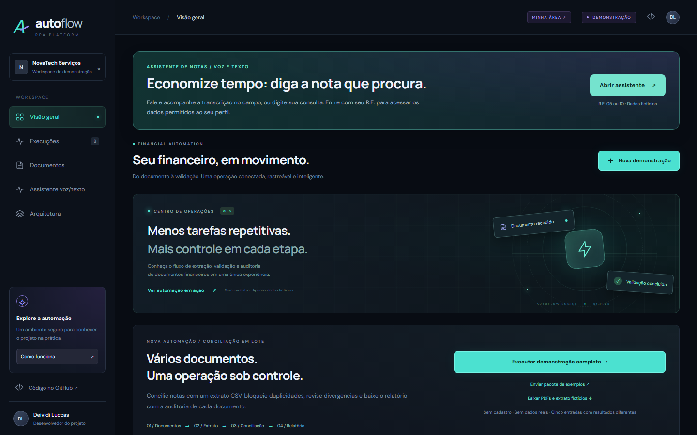
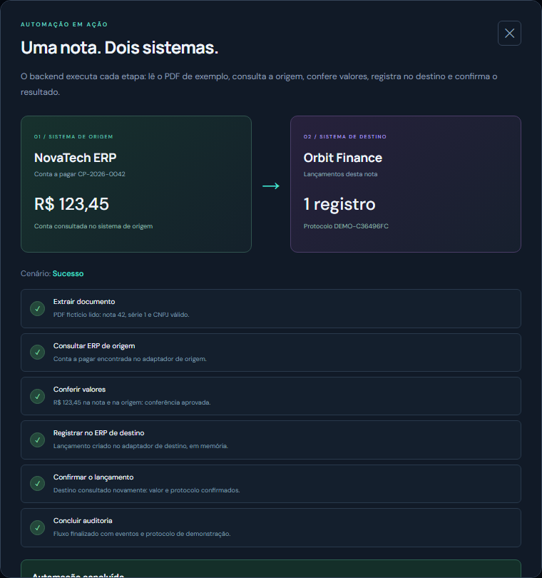
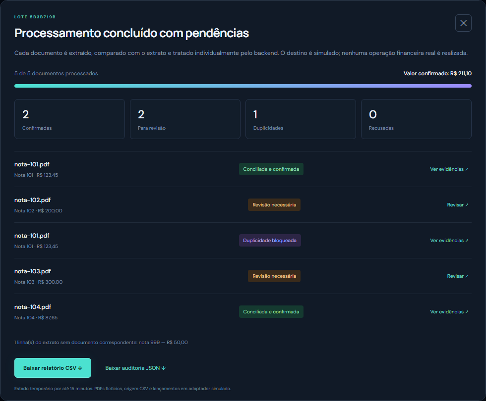
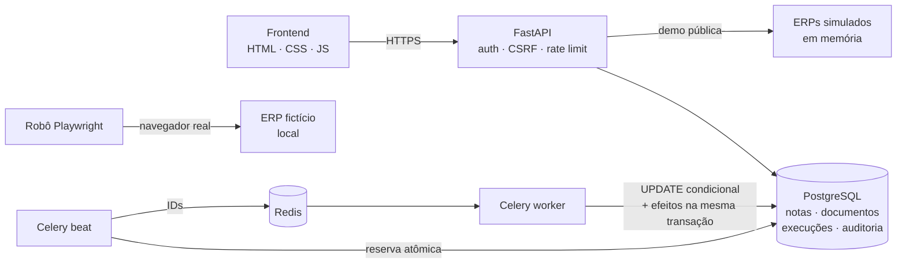

<div align="center">

# AutoFlow RPA

**Automação financeira de ponta a ponta: extração de notas, conciliação, revisão humana e auditoria.**

[](https://github.com/DeividiLuccasdev/autoflow-rpa/actions/workflows/ci.yml)


[**Demo ao vivo**](https://autoflow-rpa-api.onrender.com) · [Vídeo (28 s)](https://portfolio-deividi.vercel.app/projects/autoflow-rpa/apresentacao.mp4) ([MP4](docs/apresentacao.mp4) · [legendas](docs/apresentacao.vtt)) · [API (Swagger)](https://autoflow-rpa-api.onrender.com/docs) · [Portfólio](https://portfolio-deividi.vercel.app/)



</div>

> Projeto de portfólio. Todos os documentos, empresas e pessoas são fictícios; nenhuma operação financeira real é executada. A demo roda no plano gratuito do Render e pode levar até um minuto para acordar.

## Sobre

O AutoFlow simula o trabalho de um time financeiro que recebe notas em PDF, confere cada uma contra o sistema de origem e lança no sistema de destino. O foco está no que costuma quebrar em automações reais: **duplicidade, divergência de valores, falhas no meio do processo e rastreabilidade**.

Cada passo da demonstração é uma requisição real ao backend, com validação, idempotência e trilha de auditoria. Não é uma animação.

## Funcionalidades

| | |
| --- | --- |
| **Extração de PDF** | Parser determinístico com PyMuPDF, validação de CNPJ (dígitos verificadores), valores e limites de tamanho/páginas. |
| **Automação entre sistemas** | Fluxo de seis etapas entre um ERP de origem e um de destino simulados, com controle de versão por etapa e bloqueio de lançamento duplicado. |
| **Revisão humana** | Divergências param o fluxo antes do lançamento; aprovação exige correção e justificativa registrada na auditoria. |
| **Conciliação em lote** | PDFs × extrato CSV, com resultado por documento, pendências do extrato e relatórios CSV/JSON (com proteção contra injeção de fórmulas). |
| **Fila assíncrona durável** | Celery + Redis com reserva atômica no banco, backoff exponencial e efeitos transacionais: entregas duplicadas geram um único efeito. |
| **Robô Playwright** | Opera um ERP fictício pelo navegador: preenche, salva, confirma após recarregar e grava screenshots, vídeo e trace. |
| **Assistente por voz e texto** | Consulta de notas por R.E. com escopo por perfil aplicado no servidor e Web Speech API em pt-BR. |
| **Contas por convite** | Senhas PBKDF2, sessões opacas revogáveis, CSRF e isolamento de dados por usuário. |

<table>
  <tr>
    <td width="50%"></td>
    <td width="50%"></td>
  </tr>
  <tr>
    <td align="center"><sub>Automação entre sistemas, etapa por etapa</sub></td>
    <td align="center"><sub>Conciliação em lote com duplicidade e divergências</sub></td>
  </tr>
</table>

## Arquitetura



## Decisões técnicas

- **Fila durável no banco, Redis só com identificadores.** A execução é persistida antes de publicar; um dispatcher reserva atomicamente a janela de envio, então quedas entre reserva e publicação são recuperadas e dois dispatchers nunca enviam a mesma janela. → [detalhes](docs/queue.md)
- **Idempotência por restrição única, não por verificação prévia.** Nota (emitente + número + série) e documento (SHA-256) são únicos por usuário. Só a constraint conhecida vira `duplicate` (SQLSTATE + nome da constraint), o resto é falha.
- **Controle otimista nas demonstrações.** Cada avanço envia a versão esperada; requisições repetidas ou concorrentes não avançam duas vezes.
- **Segurança desde o início.** Autenticação antes de ler o corpo do upload, limite de corpo antes do parser multipart, CSP sem scripts inline, verificação de `Origin`, rate limit, cookies `HttpOnly`/`SameSite=Strict` e `pip-audit` no CI. → [revisão de segurança](docs/security-review.md)
- **Testes contra infraestrutura real.** PostgreSQL, Redis, Celery worker/beat e Chromium de verdade, em ambiente descartável. O runner falha se algum teste for pulado.

## Stack

| Camada | Tecnologias |
| --- | --- |
| Backend | Python 3.12, FastAPI, SQLAlchemy 2, Pydantic, Alembic |
| Processamento | Celery, Redis, PyMuPDF |
| Dados | PostgreSQL 16 (produção e testes), SQLite (desenvolvimento rápido) |
| Automação | Playwright (Chromium) |
| Frontend | HTML, CSS e JavaScript sem framework, servidos pelo FastAPI |
| Infra | Docker Compose, GitHub Actions, Render (Blueprint) |

## Como rodar

Pré-requisitos: Docker Desktop e um arquivo `.env` na raiz com `AUTOFLOW_API_KEY` (veja [execução local](docs/local-setup.md) para gerar).

```bash
docker compose up --build -d
```

Abra http://localhost:8000. A área privada fica em `/workspace` ([como ativar uma conta](docs/accounts.md)) e o Swagger em `/docs`.

Para rodar só a API com SQLite, sem Docker, siga a [execução local](docs/local-setup.md).

## Testes

```bash
python scripts/test_all.py
```

Sobe PostgreSQL, Redis, Celery e Chromium em containers descartáveis, executa as suítes Python e Node e remove tudo ao final. Nenhum banco de produção é usado.

Mais de 200 testes cobrem cadastro e upload, concorrência no PostgreSQL, entrega duplicada pelo broker, Redis indisponível, tentativas esgotadas, isolamento entre usuários, políticas HTTP, demonstrações e o robô de navegador. → [comportamentos cobertos](docs/request-specs.md)

Lint e formatação usam [ruff](https://docs.astral.sh/ruff/) (`ruff check .` e `ruff format .` na raiz; há um hook opcional de [pre-commit](https://pre-commit.com/)).

O CI (GitHub Actions) verifica lint e formatação, roda a suíte completa com relatório de cobertura, audita dependências, constrói a imagem Docker e faz um smoke test dela, e publica as evidências do robô Playwright. O deploy no Render só acontece depois que os checks passam.

## Estrutura

```text
backend/
├── app/
│   ├── api/        # rotas privadas: contas, notas e execuções
│   ├── demo/       # demonstrações públicas (automação, lotes, assistente)
│   ├── static/     # frontend HTML, CSS e JS
│   └── *.py        # configuração, modelos, segurança, extração de PDF, fila e worker
├── migrations/     # Alembic
├── rpa/            # robô Playwright
├── simulators/     # ERP fictício operado pelo robô
└── tests/          # unitários, request specs e testes de frontend
docs/               # documentação detalhada
scripts/            # geração de fixtures e runner de testes
```

## Documentação

- [Demonstração pública](docs/public-demo.md): automação, central de execuções e conciliação em lote
- [Assistente por voz e texto](docs/assistant.md): perfis, comandos e cobrança simulada
- [API privada](docs/api.md): rotas, validações e formato do PDF
- [Fila e concorrência](docs/queue.md)
- [Robô Playwright](docs/rpa-browser.md)
- [Contas por convite](docs/accounts.md)
- [Execução local](docs/local-setup.md) e [deploy no Render](docs/render-demo.md)
- [Testes](docs/request-specs.md) e [revisão de segurança](docs/security-review.md)

## Limitações conhecidas

- O parser aceita apenas o layout fictício do projeto (não lê DANFE/NFS-e e não tem OCR).
- O estado das demonstrações públicas fica em memória e exige um único processo HTTP.
- Rate limit e sessões da demo são locais ao processo; uso real exigiria controle distribuído.
- Não há RBAC por organização, recuperação de conta nem integração com ERP real.

## Roadmap

- [ ] Recuperação de conta e métricas de falha
- [ ] Reenvio operacional autorizado de execuções
- [ ] Organizações e RBAC
- [ ] OCR para documentos digitalizados
- [ ] Frontend em Next.js

## Autor

**Deividi Luccas** · [Portfólio](https://portfolio-deividi.vercel.app/) · [GitHub](https://github.com/DeividiLuccasdev)
