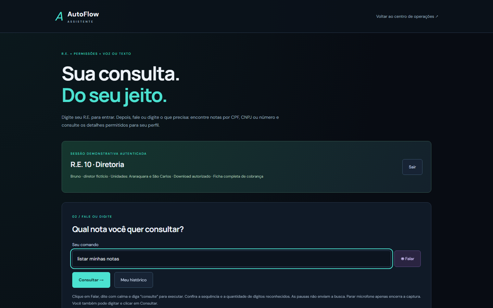

# Assistente por R.E., voz e texto

A página `/assistente` simula um acesso corporativo, isolado das contas privadas. O funcionário entra com R.E. e senha demonstrativos e depois fala ou digita comandos. Todas as pessoas, identificadores e notas são fictícios, sem valor fiscal.

## Perfis demonstrativos

Senha pública: `AutoflowDemo2026!` — use apenas nesta simulação.

| R.E. | Perfil | Vê |
| --- | --- | --- |
| `05` | Funcionário | Nota, valor devedor da nota e razão social fictícia |
| `10` | Diretoria | Tudo do funcionário + endereço, telefone, dívida total e parcelas restantes |

Os dois perfis consultam as duas unidades demonstrativas. Campos exclusivos da diretoria são omitidos **no servidor** nas buscas, nos detalhes e no PDF do funcionário.

## Comandos

- `nota 101`, `notas do CPF` seguido de 11 dígitos, CNPJ com ou sem pontuação, dígitos ditados um a um
- `listar minhas notas`, `abrir a segunda nota`, `qual o valor`, `mostrar histórico`, `baixar PDF`, `sair`

Identificadores incompletos não são completados por inferência.

## Voz

- Usa `SpeechRecognition`/`webkitSpeechRecognition` em pt-BR, somente após ação do usuário. A digitação continua sempre disponível.
- A transcrição parcial aparece ao vivo, sem consultar a API a cada palavra. O reconhecimento é contínuo e mantém os trechos entre pausas.
- A consulta por voz só é enviada quando o comando termina com a palavra **“consulte”** (resultado final). Parar o microfone nunca executa a consulta.
- Após encerramento normal ou `no-speech`, a captura é retomada em 250 ms com nova instância e identificador de sessão, ignorando eventos atrasados. Após 90 segundos sem novos trechos, o microfone para e o texto fica disponível.
- Erros de rede, permissão ou microfone exibem a causa e não reiniciam automaticamente. A interface mostra quantos dígitos foram reconhecidos e não infere zeros ausentes.
- O navegador pode enviar o áudio ao seu serviço de reconhecimento, conforme o aviso exibido. O aplicativo não grava áudio, e a política de microfone só é liberada em `/assistente`.

Os testes de regressão simulam eventos de reconhecimento no Node.js (`backend/tests/voice_frontend.test.cjs`), incluindo 11 dígitos com interrupção, várias retomadas e eventos atrasados.

## Nota e e-mail de cobrança simulado

Ao abrir uma nota, **Gerar nota e enviar cobrança** gera o PDF conforme o perfil, preenche um e-mail de cobrança com remetente, destinatário e texto definidos no servidor e registra um envio **simulado**. Não há SMTP nem API de e-mail.

- Repetir a operação para a mesma nota na mesma sessão retorna o mesmo protocolo e os mesmos bytes do PDF.
- Outro R.E. ou outra sessão não acessa esse histórico.

Rotas: `POST /assistant/documents/{id}/collection` (corpo `{}` + CSRF), `GET /assistant/collections`, `GET /assistant/collections/{protocolo}/pdf`.

## Segurança da sessão

- Cookie opaco `HttpOnly`, `SameSite=Strict` e `Secure` em HTTPS; POSTs exigem token CSRF.
- Sessão de até 20 minutos, revogável e volátil, com limite de 128 sessões e 100 eventos por sessão.
- A auditoria não armazena áudio nem a transcrição integral com CPF/CNPJ.
- A sessão do assistente não autoriza a API privada de documentos.

## Fora do escopo

Não há SSO, diretório corporativo, R.E.s reais, documentos privados existentes nem consulta governamental por CPF/CNPJ. Uma integração real precisaria associar o R.E. autenticado a permissões administradas e a uma fonte documental autorizada.

Referência: [Web Speech API (MDN)](https://developer.mozilla.org/en-US/docs/Web/API/Web_Speech_API/Using_the_Web_Speech_API).
